# Clinic SaaS

A Saudi-first, multi-tenant clinic management platform for small and new clinics: Arabic-first (RTL) with English,
one shared deployment, strict isolation between clinics.

> **Status:** Phase 2 (local MVP) is in progress. The product runs locally end to end; it is **not
> production-ready** and makes **no compliance claim** (PDPL, NCA, MOH, ZATCA). The single source for phase, gates,
> decisions and verified results is [`docs/STATUS.md`](docs/STATUS.md).

<div dir="rtl">

## وش هو عيادتي؟

نظام سحابي لإدارة العيادات الصغيرة والناشئة في السعودية، مبني بحيث كل عيادة تشتغل بمعزل تام عن غيرها رغم إنها
كلها على نفس المنصة (multi-tenant) — عربي RTL أول شي، مع دعم إنجليزي كامل جنبه مو مجرد ترجمة.

يغطي النظام دورة العيادة من أولها لآخرها:

- تسجيل عيادة جديدة وتجربة مجانية 14 يوم، بدون بطاقة.
- دعوة الموظفين وتوزيعهم على أدوار وصلاحيات (استقبال، تمريض، طبيب، محاسبة، إدارة) — وكل دور له بوابة دخول خاصة.
- ملفات الأطباء وساعات عملهم (فترة صباحية ومسائية لكل يوم من أيام الأسبوع).
- حجز المواعيد مع منع التعارض (ما ينحجز نفس الوقت لنفس الطبيب مرتين)، وحضور بدون موعد بترقيم دور تلقائي.
- ملف المريض الطبي، وتنبيه الحساسية والأمراض المزمنة يطلع قدام عين الطبيب أينما احتاجه — حتى داخل نافذة كتابة
  الوصفة، مو بس بصفحة الزيارة.
- خطط اشتراك وحدود استخدام تتحكم فيها المنصة، وفوترة يدوية من لوحة المشرف.

من الناحية التقنية:

- **الباك إند:** ASP.NET Core 10 و Clean Architecture على SQL Server، وعزل المستأجرين بثلاث طبقات مو طبقة وحدة
  (query filters + حارس عند الحفظ + مفاتيح مركّبة) عشان ما يصير تسريب بيانات بين عيادة وثانية.
- **الفرونت إند:** Next.js 16 و TypeScript و Tailwind v4، عربي RTL / إنجليزي عبر next-intl.
- **الهوية:** JWT مع تدوير refresh token وكشف إعادة الاستخدام، والصلاحيات متحقق منها في الكود نفسه مو بس بإخفاء
  زر بالواجهة.

المشروع لسا بمرحلة MVP محلي، وما يدّعي امتثال PDPL أو NCA أو وزارة الصحة أو زاتكا إلى أن يصير تحقق رسمي.

### لقطات من النظام

<table>
<tr>
<td width="50%">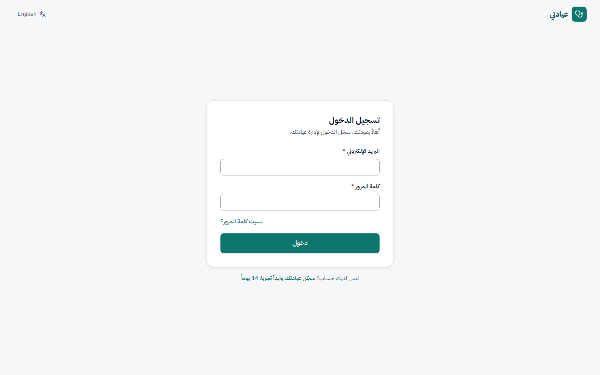</td>
<td width="50%">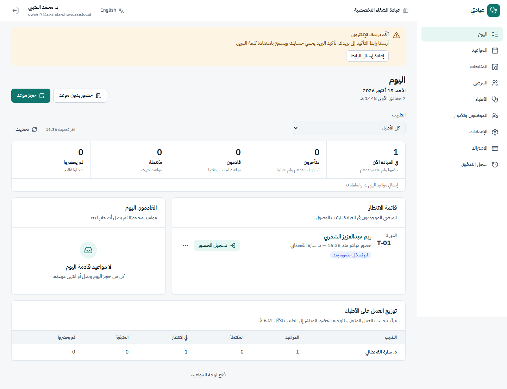</td>
</tr>
<tr>
<td align="center"><sub>تسجيل الدخول — شاشة هادئة بلا زخارف</sub></td>
<td align="center"><sub>لوحة اليوم — قائمة الانتظار وتوزيع العمل على الأطباء</sub></td>
</tr>
<tr>
<td width="50%">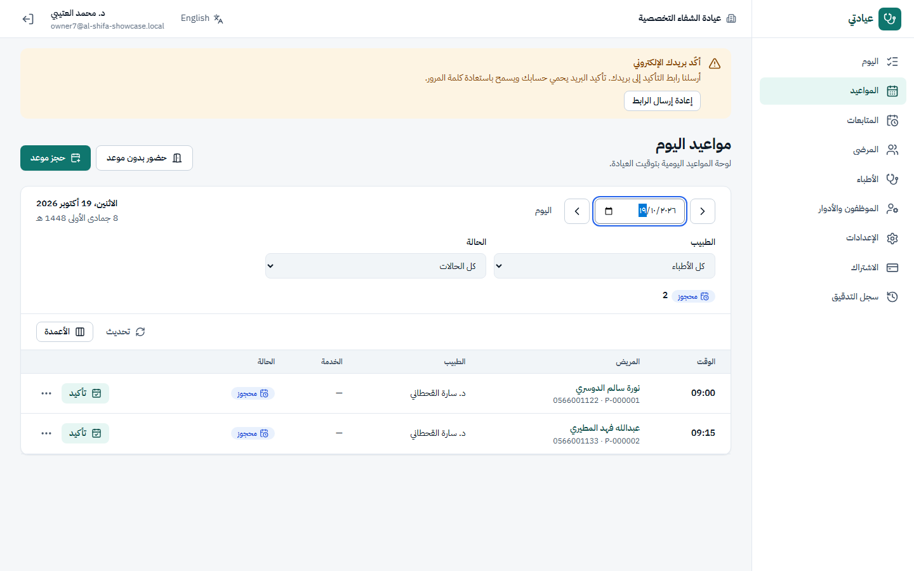</td>
<td width="50%">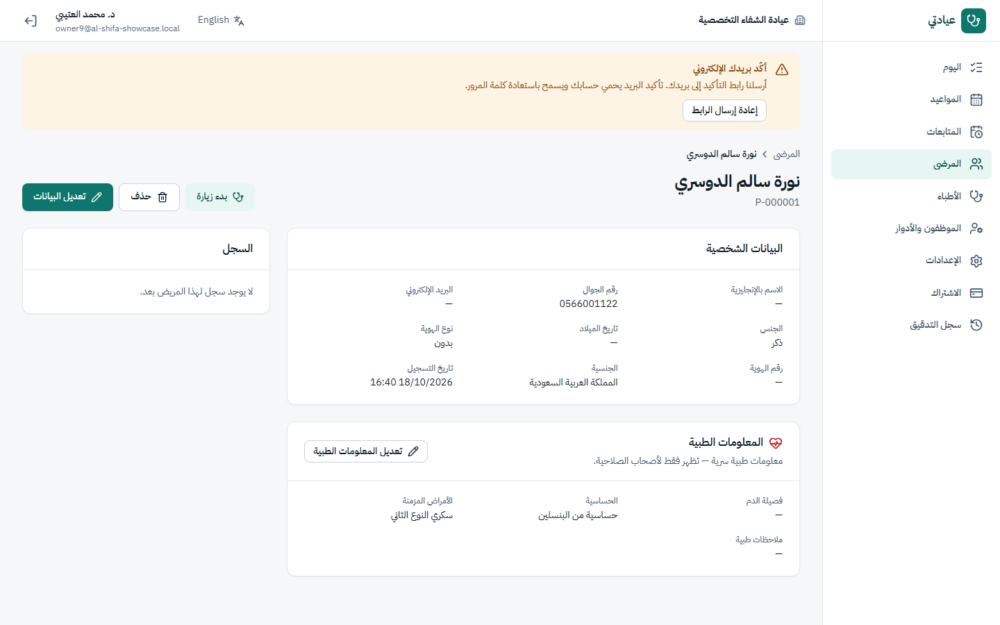</td>
</tr>
<tr>
<td align="center"><sub>جدول المواعيد اليومي</sub></td>
<td align="center"><sub>ملف المريض — تنبيه الحساسية والأمراض المزمنة بارز</sub></td>
</tr>
<tr>
<td width="50%">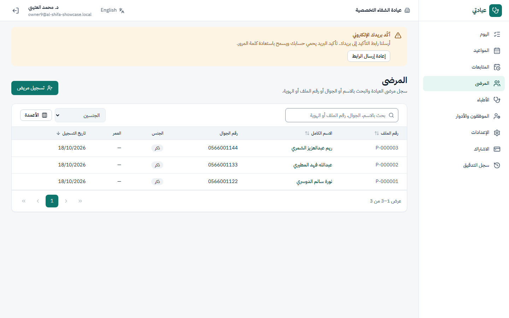</td>
<td width="50%">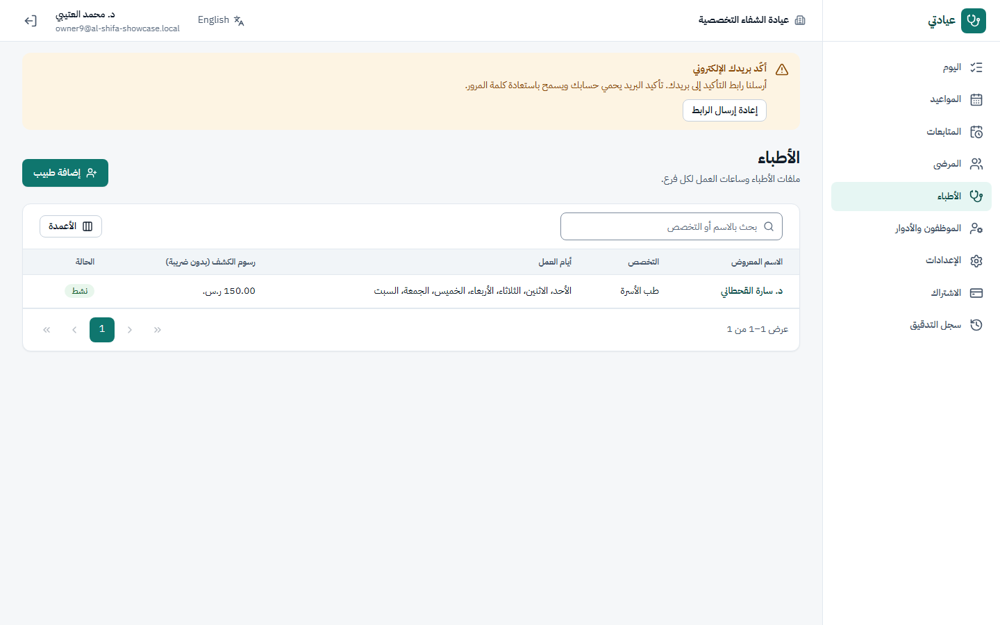</td>
</tr>
<tr>
<td align="center"><sub>سجل المرضى</sub></td>
<td align="center"><sub>قائمة الأطباء</sub></td>
</tr>
<tr>
<td width="50%">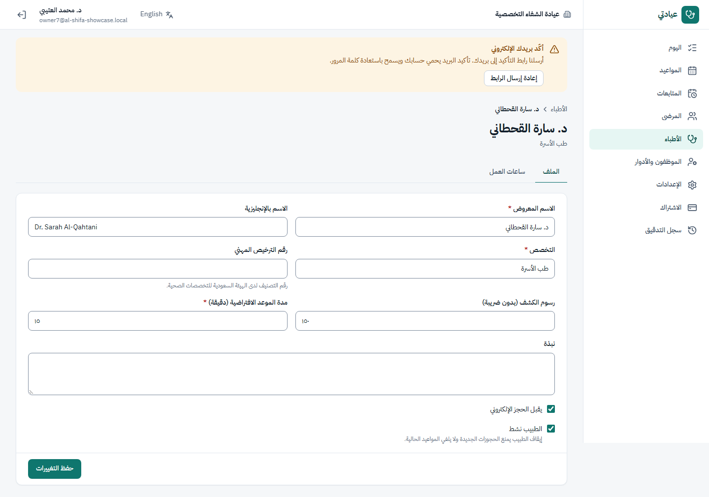</td>
<td width="50%">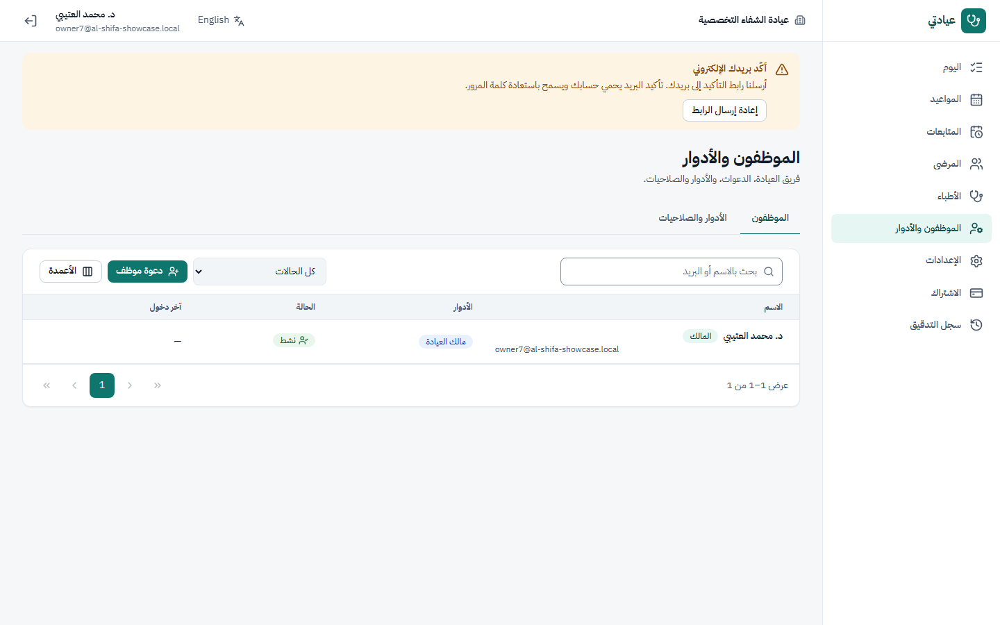</td>
</tr>
<tr>
<td align="center"><sub>ساعات عمل الطبيب</sub></td>
<td align="center"><sub>الموظفون والأدوار</sub></td>
</tr>
<tr>
<td width="50%">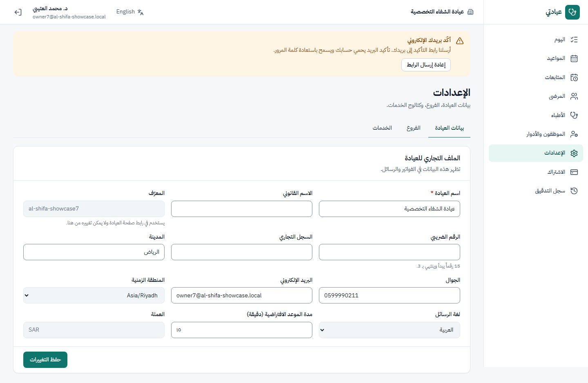</td>
<td width="50%">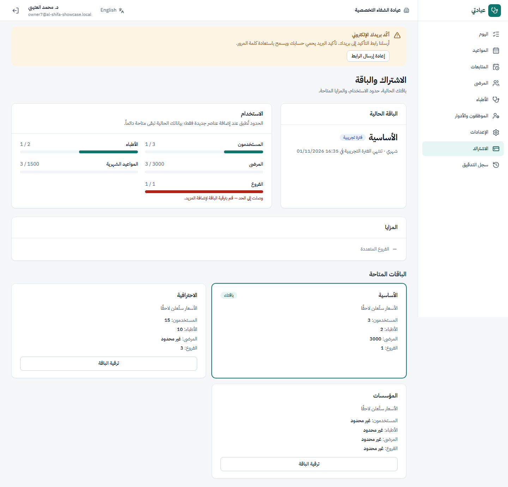</td>
</tr>
<tr>
<td align="center"><sub>إعدادات العيادة</sub></td>
<td align="center"><sub>خطة الاشتراك</sub></td>
</tr>
<tr>
<td width="50%">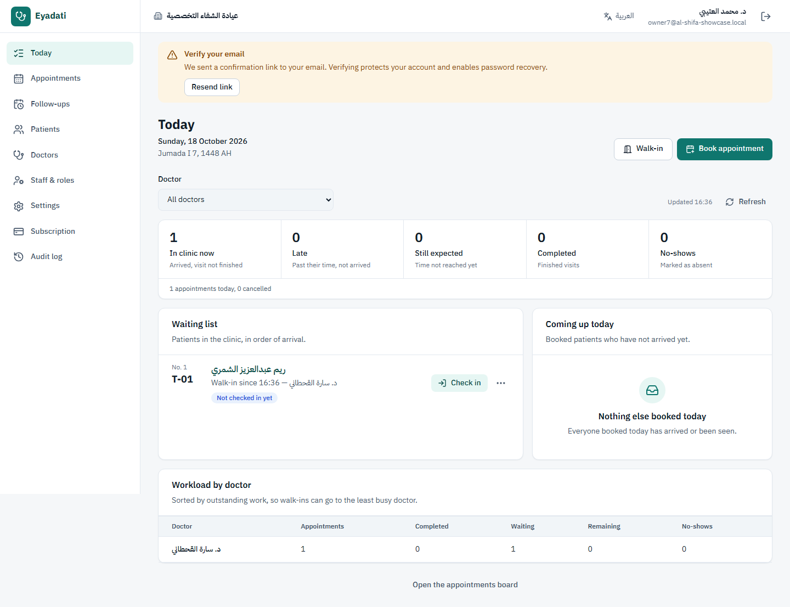</td>
<td width="50%">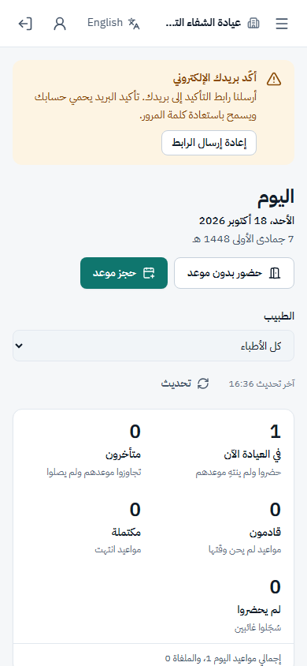</td>
</tr>
<tr>
<td align="center"><sub>English — full LTR layout, not just a translated screenshot</sub></td>
<td align="center"><sub>نفس اللوحة بعرض الجوال</sub></td>
</tr>
</table>

بيانات تجريبية وهمية بالكامل، ما فيها أي معلومات مريض حقيقية.

</div>

## What it does

- Clinic self-registration (14-day trial), staff invitations, roles and permissions, branch restriction.
- Patients, doctors with working hours (split shifts), services, appointments with double-booking protection,
  walk-in queue tokens, check-in and a role-based "Today" queue.
- Doctor workflow: visit with vitals, findings and diagnosis → completion → prescription by the treating doctor →
  printable prescription → patient history.
- SaaS plans and limits with manual billing: a platform admin sets each clinic's plan and billing period; an
  ended period makes the clinic read-only; suspension takes effect immediately.

## Architecture

```text
Browser ──► frontend/  Next.js 16 (App Router, TypeScript, Tailwind v4, next-intl ar/en, RTL-first)
               │  JSON over HTTPS · access token in memory · refresh token in an httpOnly cookie
               ▼
            backend/   ASP.NET Core 10 API (/api/v1) · Clean Architecture
               │         Api → Application → Domain, Infrastructure (EF Core 10)
               ▼
            SQL Server (shared database, TenantId on every clinic row)
```

- **Tenant isolation in three layers:** EF Core global query filters, a SaveChanges guard that refuses
  cross-tenant writes (stored `TenantId` checked on every update/delete), and composite foreign keys
  (`TenantId` + `Id`). Tested by dedicated isolation suites.
- **Identity:** one global `User`, access per clinic through `TenantMembership`; JWT access tokens (15 min) with
  refresh-token rotation and reuse detection, lockout, rate limiting.
- **Authorization:** permissions in code, roles as per-clinic data; branch and own-doctor scoping for clinical
  records; platform (super-admin) and clinic sessions never share a token.
- **Clinic access check on every request:** suspended clinic → `TENANT_SUSPENDED`; ended subscription →
  read-only (`SUBSCRIPTION_EXPIRED` on writes).

More: [security model](docs/04-security-model.md) · [API reference](docs/05-api-reference.md) ·
[database schema](docs/database/schema.md) · [target architecture](docs/02-target-architecture.md).

## Repository layout

```text
backend/    ASP.NET Core solution (src: Domain, Application, Infrastructure, Api · tests: Unit, Integration)
frontend/   Next.js web app
docs/       status, security model, API reference, database docs, QA reports
scripts/    agent workflow helpers (PowerShell)
.github/    CI workflow
```

## Local development

### Prerequisites

- .NET SDK 10 and `dotnet tool install -g dotnet-ef`
- Node.js 22 and npm
- SQL Server: LocalDB on Windows, or a container elsewhere:

```bash
docker run -d --name clinic-sql -p 1433:1433 -e ACCEPT_EULA=Y -e 'MSSQL_SA_PASSWORD=<local-only-password>' \
  mcr.microsoft.com/mssql/server:2022-latest
```

### Backend

```bash
cd backend
# Windows with LocalDB: no extra settings needed (appsettings.Development.json).
# Elsewhere, point at your SQL Server:
export ConnectionStrings__Default='Server=localhost,1433;User ID=sa;Password=<local-only-password>;TrustServerCertificate=True;Database=ClinicSaaS_Dev'
dotnet run --project src/ClinicSaaS.Api --launch-profile http     # http://localhost:5056
```

Development migrates the database on startup and generates a throw-away JWT key. Emails (invitations, email
verification, password reset) are **not sent**: they are written as HTML files to `.dev-mailbox/` — open the link
from there. This development mailbox is refused outside Development (GD-05). See [backend/README.md](backend/README.md)
for configuration.

### Frontend

```bash
cd frontend
npm ci
npm run dev        # http://localhost:3000 (API at http://localhost:5056 unless NEXT_PUBLIC_API_URL is set)
```

## Testing

```bash
# Backend: unit + integration (integration tests create and drop ClinicSaaS_Test_<guid> databases)
cd backend
export CLINICSAAS_TEST_SQL_SERVER='Server=localhost,1433;User ID=sa;Password=<local-only-password>;TrustServerCertificate=True'   # omit on Windows LocalDB
dotnet test ClinicSaaS.slnx
dotnet ef migrations has-pending-model-changes -p src/ClinicSaaS.Infrastructure -s src/ClinicSaaS.Api

# Frontend
cd frontend
npm run lint && npm run typecheck && npm test && npm run build
```

CI (`.github/workflows/ci.yml`) runs the same checks on every push and pull request.

Browser regression suite (core owner / reception / doctor / security / account flows, RTL+LTR at four widths, axe):
`npm run test:e2e` against a running local stack — setup in [`frontend/e2e/README.md`](frontend/e2e/README.md). It is
not part of CI yet (it needs the API, the web app and SQL Server running together).

## Database changes

Schema changes need explicit approval and follow [`docs/database/schema-changelog.md`](docs/database/schema-changelog.md).
Production applies reviewed idempotent scripts from `docs/database/`; automatic migration is refused in Production.

## License

`LICENSE` contains the MIT license of the open-source project this repository was originally derived from
(copyright Abdul Rehman). That application has been removed, but parts of its design and logic were ported and it
remains in the git history, so its copyright and permission notice are kept as the license requires. The licensing
of the new Clinic SaaS code is a decision for the project owner and has not been changed here.
